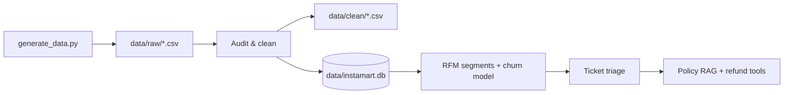

# 🛒 Customer Intelligence & Support Copilot

> An end-to-end AI support system for a fictional quick-commerce platform (Instamart-style): clean the data, segment customers, predict churn, triage support tickets, and answer policy and refund questions with a retrieval-grounded co-pilot.
>
> **Everything is synthetic and offline.** No real customer data, hosted LLM, API key or network call is needed — `mock_llm.py` stands in for the LLM.

---

## 📌 Use case

Quick-commerce promises delivery in minutes, so a late order, a failed payment or a wrong invoice quickly turns into a support ticket — and a lost customer. This project builds the intelligence layer behind a support team:

| Business question | Part | Answer |
|---|---|---|
| Can we trust our order data? | **A** | Audit, clean and validate raw exports, then load them into SQLite |
| Who are our customers, and who is about to leave? | **B** | RFM segmentation (K-means + PCA) and a churn (lapse) model |
| Which team should handle each ticket? | **C** | Privacy-safe ticket classification and routing |
| What does policy say, and can this refund be approved? | **D** | Policy RAG plus order / refund tools with human escalation |

## 🔄 Pipeline



Segment names from Part B are used by Part C when routing tickets (for example, Premium customers go to the premium desk).

## 🎯 Learning outcomes

1. Fetch/read CSV exports and audit data quality
2. Clean data and persist trusted tables in SQLite
3. Write SQL and pandas analytics, and reconcile the two
4. Segment customers (RFM, K-means, PCA, silhouette) and train a leakage-aware churn model
5. Redact PII and triage text with retries and output validation
6. Retrieve policy passages and run bounded, database-backed tools

---

## 🚀 Quick start

Python 3.11+ recommended.

```bash
python -m venv .venv

# Windows PowerShell
.venv\Scripts\Activate.ps1
# macOS / Linux
# source .venv/bin/activate

python -m pip install --upgrade pip
pip install -r requirements.txt
python generate_data.py
python run_project.py
```

Then open `notebooks/Customer_Intelligence_Support_Copilot.ipynb` and run the cells from top to bottom. The notebook calls the same modules the scripts use.

## 🗂️ Repository map

```text
├── generate_data.py        # deterministic fictional CSVs + policy text files
├── mock_llm.py             # offline stand-in for classification, policy answers, agent tool calls
├── run_project.py          # runs Parts A–D in sequence, ending with a sample refund request
├── requirements.txt
├── GITHUB_RESOURCES.md
├── .gitignore
├── notebooks/
│   └── Customer_Intelligence_Support_Copilot.ipynb
├── src/
│   ├── data_pipeline.py    # audit, clean, SQLite load, validation
│   ├── customer_models.py  # RFM, K-means, PCA, churn (lapse) model with train/test separation
│   ├── triage.py           # token guardrails, PII redaction, retries, validation, routing
│   ├── policy_rag.py       # chunking, TF-IDF retrieval, grounded policy evaluation
│   └── refund_agent.py     # order lookup, refund calculation, ledger, bounded tool loop
├── sql/queries.sql         # seven SQL patterns: WHERE/HAVING, joins, subquery, anti-join, CTE, window ranks, running total
├── data/                   # raw/, clean/, policies/*.txt, instamart.db  (generated)
├── outputs/                # segments, retention list, model, triage results, refund ledger (generated)
└── state/                  # agent checkpoint examples
```

---

## 🧩 Part summaries

### Part A — Data foundation
The generator deliberately injects messy data — mixed city casing and stray spaces, gender variants, blank and impossible ages, duplicate and `pending` order rows, non-numeric amounts, negative and blank delivery times — and Part A fixes it. It reads the raw exports with `keep_default_na=False`, audits them, applies documented cleaning rules, writes clean CSVs and SQLite tables, and runs validation checkpoints before any modelling.

- Standardize city (title case) and gender (male / female / unknown); treat impossible ages as missing and fill with the city median
- Parse timestamps, drop exact duplicates, keep the latest row per order ID
- Coerce invalid amounts to missing and recompute from product price × quantity × discount
- Set negative delivery times to missing; impute completed orders only, by product-category median (cancelled orders keep a missing duration)

### Part B — Customer segmentation and churn prediction
- **RFM** on completed orders with a fixed snapshot date (2025-10-01): *Recency* (days since last completed order), *Frequency* (distinct completed orders), *Monetary* (total spend)
- **K-means** (on standardised RFM) compared for K = 2…8 using inertia and **silhouette score**; the notebook uses K = 4. Segments are named *Premium* (highest average spend), *Frequent* (frequency at or above the median) or *At Risk* — recency is not part of the naming rule, so more than one segment can be called *At Risk*
- **PCA** to check how much RFM variance two components retain
- **Churn model:** the churn target is a *lapse* label — a customer is lapsed if they place **no completed order in September 2025**. Features use only orders **before 2025-09-01**; scaler and encoder are fitted inside a training pipeline (`GridSearchCV`, `LogisticRegression` vs `RandomForestClassifier`, 80/20 stratified split) and the random forest is saved to `outputs/lapse_model.joblib`
- **Caveat:** the Premium retention list is *illustrative* — the Premium flag comes from whole-window RFM, so it is not a leakage-free evaluation

### Part C — Ticket triage and privacy
- Empty and overlong tickets are blocked before any model call
- Email → phone → order ID are redacted before prompting
- `mock_llm.py` deliberately injects failures (a simulated 503 on every 9th call, occasional prose replies, an occasional invalid category) so the retry and validation paths are exercised
- Retries (up to 4 attempts, exponential back-off) handle simulated transient errors; JSON categories are allow-listed, and malformed output is accepted only if exactly one allowed category is detectable
- Run Part B first: routing reads `outputs/customer_segments.csv`, and without it `segment_name` is blank and nobody is routed to the premium desk
- Routing: guardrail / invalid / budget cases → human review, fraud → security team, Premium customers → premium desk, everything else → support queue
- The notebook also builds an output dictionary (ticket details + routing decision) and compares predicted categories with the labelled `true_category`

### Part D — Policy retrieval and refund tools
- Policies are chunked with overlap, vectorised with `TfidfVectorizer` and ranked by cosine similarity; answers must come from retrieved context, with a fallback when the question is not covered
- Tools: `get_order` (SQLite lookup), `search_policy` (the RAG index), `calculate_refund`, `issue_refund` and `escalate_to_human` (the last two append to `outputs/refund_ledger.jsonl`)
- Rules: only `completed` orders can be refunded; delivery in **over 45 minutes** earns a full refund (`calculate_refund`); a refund **over INR 1000** is escalated to a human lead instead of auto-issued (the policy text requires human approval, and the mock agent calls `escalate_to_human`)
- Agent outcomes: `REFUND`, `ESCALATE`, `DENIED`, `NEEDS_INFO` (no order id), `NOT_FOUND` (unknown order), or a `FALLBACK_*` hand-off
- The agent loop is bounded (6 iterations, 6,000 tokens, 10 seconds by default); hitting any limit hands off to a human agent, and each step is checkpointed to `state/`. The ledger is a local JSONL file — **no money moves**

---

## 📊 Reference run (from the notebook outputs)

| Area | Result |
|---|---|
| Orders | 13,084 raw rows → 12,309 after de-duplication (119 exact duplicates, 656 state-update rows) |
| Customers | 1,200 rows; 61 blank ages, 30 blank genders, 24 raw city spellings, 10 raw gender spellings |
| Segmentation | K = 4, silhouette 0.526; PCA (2 components) explains 85.2% of variance |
| Churn (lapse) | 443 lapsed of 1,156 customers; baseline accuracy 0.616 (predicting nobody lapses) |
| Triage | 164 tickets: 135 classified (JSON), 12 classified (keyword fallback), 9 flagged invalid output, 4 skipped empty, 4 flagged long |
| Policy RAG | 14 evaluation questions: 12 expected-document hits, 12 expected-fact hits, 2 correct fallbacks |
| Refund agent | late order ≤ INR 1000 → `REFUND`; late order > INR 1000 → `ESCALATE`; on-time or cancelled order → `DENIED` |

Figures come from the fixed random seed in `generate_data.py`. If your rubric specifies numeric checkpoints, run them and reconcile any differences — do not hardcode expected answers.

## 📦 Generated artifacts

- `data/raw/`: `customers.csv`, `products.csv`, `orders.csv`, `tickets.csv`, `policy_eval.csv` (policy evaluation questions — the brief calls this file `policy_evaluation.csv`)
- `data/clean/`: `customers.csv`, `orders.csv`, `products.csv`; `data/instamart.db`
- `data/policies/`: the policy `.txt` files read by the RAG layer
- `outputs/`: `customer_segments.csv`, `retention_list.csv`, `lapse_model.joblib`, `triage_results.csv`; `refund_ledger.jsonl` appears once the agent issues or escalates a refund

## 🛠️ Troubleshooting

| Symptom | Check |
|---|---|
| Import errors | Virtual environment activated? Packages installed from `requirements.txt`? Running from the repository root? |
| Data not found | Run `python generate_data.py` first and confirm `data/raw/` exists |
| Notebook kernel not found | Install the Jupyter extension in VS Code and restart it |
| Git push fails | Confirm you are signed in to GitHub in VS Code, or push from the command line |

## 📚 Learning resources

Use these to learn patterns, and cite them in your notes — do not copy someone else's capstone.

- [pandas](https://github.com/pandas-dev/pandas) — CSV loading, cleaning, groupby, pivot tables
- [scikit-learn](https://github.com/scikit-learn/scikit-learn) — pipelines, preprocessing, clustering, model selection, metrics, TF-IDF
- [scikit-learn text feature extraction](https://scikit-learn.org/stable/modules/feature_extraction.html#text-feature-extraction)
- [Python tutorial](https://github.com/python/cpython/tree/main/Doc/tutorial) · [Jupyter Notebook](https://github.com/jupyter/notebook) · [SQLite](https://github.com/sqlite/sqlite)

## ⚠️ Limitations and next steps

- This is a teaching implementation; it may need adjusting to match every numeric checkpoint in a strict grading rubric
- The offline mock model is a deterministic, rule-based simulation, not a real language model
- The refund ledger is a local audit trail, not a transaction system
- Production would add access controls, secret management, monitoring, schema contracts, data lineage, drift checks and human approval workflows
